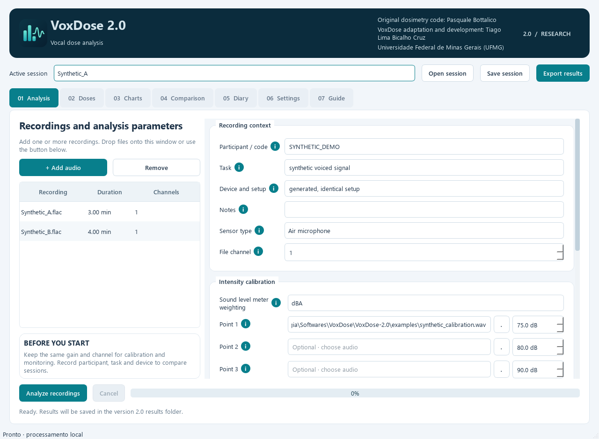
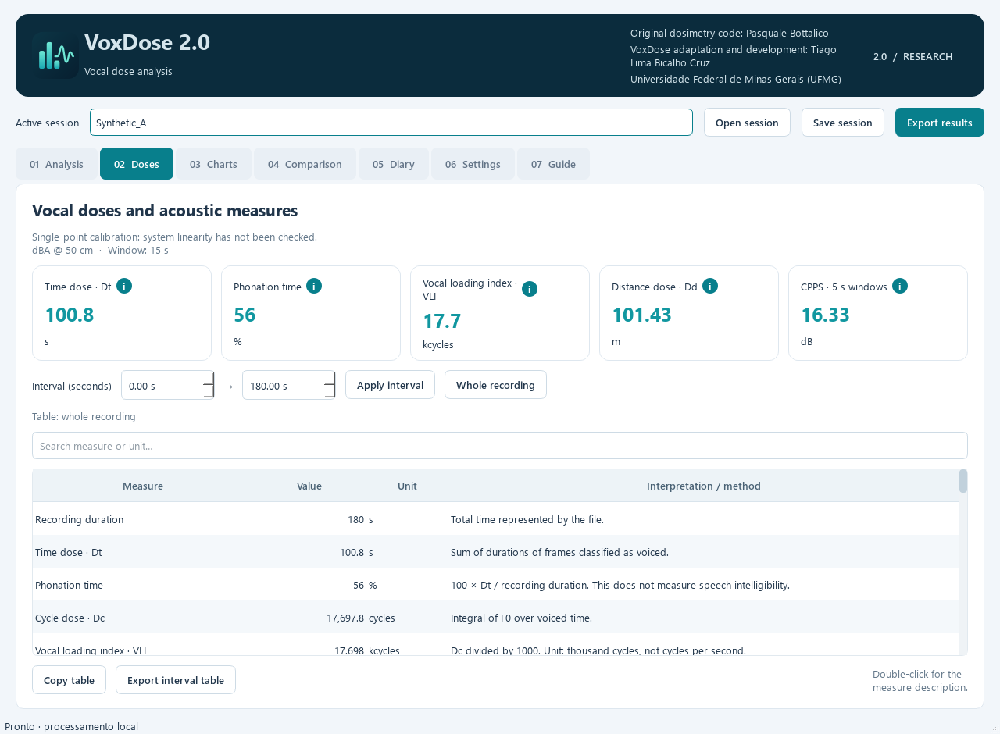

# VoxDose 2.0


Scientific software for vocal dose analysis, comparison of long recordings, and descriptive self-reports of vocal effort and fatigue. Current revision: **2.0.2**.

**Original MATLAB dosimetry code: Pasquale Bottalico.**  
**VoxDose adaptation, development and modernization: Tiago Lima Bicalho Cruz — Universidade Federal de Minas Gerais (UFMG), Brazil.**

The original algorithms and dose framework remain credited separately from the implementation and changes in VoxDose. See [METHODS](docs/METHODS.md) for numerical methods and corrections. This is a research tool; its outputs do not establish a diagnosis or a universal fatigue threshold.

[](https://doi.org/10.5281/zenodo.24253185)

[Português brasileiro](README.pt-BR.md) · [English manual](docs/Manual_en.pdf) · [Manual em português](docs/Manual_pt_BR.pdf) · [Changes](CHANGELOG.md)



## Capabilities

- PySide6 interface with Analysis, Doses, Charts, Comparison, Diary, Settings and Guide tabs.
- **English by default**, persistent Brazilian Portuguese selection, light/dark themes, and immediate help on hovering over `(i)`, without clicking or dismissing a dialog. Help can be disabled in Settings.
- Block processing for long recordings, progress reporting and cancellation.
- Phonation time/percentage, cycle dose, VLI, modeled distance/energy/radiation doses, F0, level, CPPS/HNR and pause summaries, with explicit units and availability conditions.
- A/Z calibration for air microphones; dedicated experimental contact-sensor calibration and comparison restrictions.
- Comparison of long recordings using absolute or relative time, rates normalized by duration, and compatibility checks.
- Combined and individual figures, configurable plots, a full results-table PNG, Excel, CSV and SVG exports.
- Reopenable `.voxdose` sessions and local processing, without cloud audio uploads.



## Run from source

Use Python **3.11 or newer**. From the repository root, create an environment:

```bash
python -m venv .venv
```

Activate it on Windows:

```powershell
.\.venv\Scripts\Activate.ps1
```

Or on macOS/Linux:

```bash
source .venv/bin/activate
```

Then install and start:

```bash
python -m pip install --upgrade pip
python -m pip install -e ".[dev]"
python main.py
```

The `voxdose` command is also available. The required Praat package is `praat-parselmouth`; the unrelated `parselmouth` package is not a substitute. Prefer WAV/FLAC; other formats depend on `libsndfile` support.

The `examples` directory contains **artificial signals and ratings**, not patient data or normative references. Open `Synthetic_A.voxdose` and `Synthetic_B.voxdose` to explore comparison. For reanalysis, select the calibration file from your own checkout.

## Calibration and interpretation

Without calibration, levels are digital (dBFS), with available time/cycle/periodicity measures. Modeled Dd, De and Dr require valid **Z-weighted SPL**. Do not interchange dBA and dBZ or transfer calibration between gains, placements, devices or couplings.

De is reported in **J/m³** and Dr in **J**. CPPS/HNR are acoustic measures, not direct fatigue measures. Diary ratings are descriptive 0–10 self-reports, not a replacement for a validated questionnaire. Contact-sensor outputs remain experimental. The [research report](docs/REPORT.md) explains the Hunter and collaborators literature review and its limits.

## Windows application and installer

The tested Windows delivery comprises a single-file `VoxDose-2.0.exe` and an **NSIS installer** containing the application, both PDF manuals, attribution, shortcuts and uninstaller. Python is included in these binaries. Download the [Windows installer](https://github.com/tiagolbc/VoxDose/releases/download/v2.0.2/VoxDose-2.0.2-Windows-Setup.exe), [portable EXE](https://github.com/tiagolbc/VoxDose/releases/download/v2.0.2/VoxDose-2.0.exe), or [portable ZIP with documentation](https://github.com/tiagolbc/VoxDose/releases/download/v2.0.2/VoxDose-2.0-Windows-portable.zip) from the [published release](https://github.com/tiagolbc/VoxDose/releases/tag/v2.0.2). Checksums and both manuals are attached to the same release. Large binaries are distributed as release assets rather than Git source files.

To build on Windows:

```powershell
python -m pip install pyinstaller
python tools/build_windows.py
$env:MAKENSIS = 'C:\Program Files (x86)\NSIS\makensis.exe'
python tools/build_installer.py
```

Install NSIS separately and adjust `MAKENSIS` to its actual path. The installer defaults to the current user's `%LOCALAPPDATA%\Programs\VoxDose 2.0`. Installed data is stored under `%LOCALAPPDATA%\VoxDose`; portable data goes alongside the EXE. Uninstallation preserves results and preferences.

## macOS build status

**No macOS binary has been generated or validated for this revision.** A native builder is included:

```bash
bash Build-macOS.command
```

Run it **on macOS**, with Python 3.11+ available. It builds an architecture-specific `.app`, runs three runtime-verification rounds, then creates `.dmg` and `.pkg` files. It does not claim a universal binary. Developer ID signing can be supplied through `APPLE_CODESIGN_IDENTITY`; Apple notarization and installer signing are not configured. Mac data goes under `~/Library/Application Support/VoxDose`, outside the bundle.

The `.pkg` produced internally by a **Windows** PyInstaller build is a Windows CArchive, not an Apple installer. It must not be advertised as a Mac download. See [release notes](docs/RELEASE_2.0.2.md).

## Validation

```bash
python -m pytest -q
python tools/validate_synthetic.py
```

The regression suite contains **53 tests**. The recorded Windows delivery passed three isolated-EXE rounds, each with 53 source tests and 45 application checks, plus three actual NSIS install/launch/uninstall cycles, each with 13 installer checks and the application checks. See [validation records](validation/README.md).

The independent synthetic ground-truth study met **142/144 acceptance criteria**. Two F0 precision criteria at SNR 10 dB remain unmet; `validate_synthetic.py` intentionally exits with code 1 to expose them. CPPS/HNR lack assigned analytical ground truth. These tests verify code and model equations, not clinical validity or robustness in every real recording. Windows portability was checked with isolated copies and Python removed from PATH, rather than in a clean VM.

## Citation

For analyses performed with **version 2.0.2**, cite the version-specific Zenodo DOI:

> Cruz, T. L. B. (2026). *VoxDose 2.0: scientific vocal dose analysis* (Version 2.0.2) [Computer software]. Zenodo. https://doi.org/10.5281/zenodo.24253185

The [concept DOI](https://doi.org/10.5281/zenodo.17219232) represents **all versions** and resolves to the latest archived version; it does not identify a fixed software version. GitHub's **Cite this repository** reads the version-specific DOI from [CITATION.cff](CITATION.cff). A [BibTeX entry](docs/citation.bib) is also provided.

The software citation identifies the VoxDose adaptation and development. **Pasquale Bottalico's original MATLAB dosimetry code remains explicitly credited**; cite the original dosimetry sources when describing the underlying methods, as listed in CITATION.cff and METHODS.

## Documentation and history

- [English manual](docs/Manual_en.pdf) and [Brazilian Portuguese manual](docs/Manual_pt_BR.pdf).
- [Methods](docs/METHODS.md), [research/development report](docs/REPORT.md), and [2.0.2 release notes](docs/RELEASE_2.0.2.md).
- [CITATION.cff](CITATION.cff) and [NOTICE](NOTICE.txt) retain provenance and attribution.
- [legacy/v1](legacy/v1) preserves the former GitHub source, tests and metadata. The existing `paper.md`, bibliography and historical figures remain unchanged and describe the earlier implementation.

The repository's existing **non-commercial LICENSE** is preserved; read [LICENSE](LICENSE) for its actual terms. Third-party authorship/licenses remain applicable. These terms are not relabeled as an unrestricted MIT license.

Key references: [Bottalico & Nudelman (2023)](https://doi.org/10.1044/2023_JSLHR-23-00060) and [Titze, Švec & Popolo (2003)](https://pmc.ncbi.nlm.nih.gov/articles/PMC3158591/).
