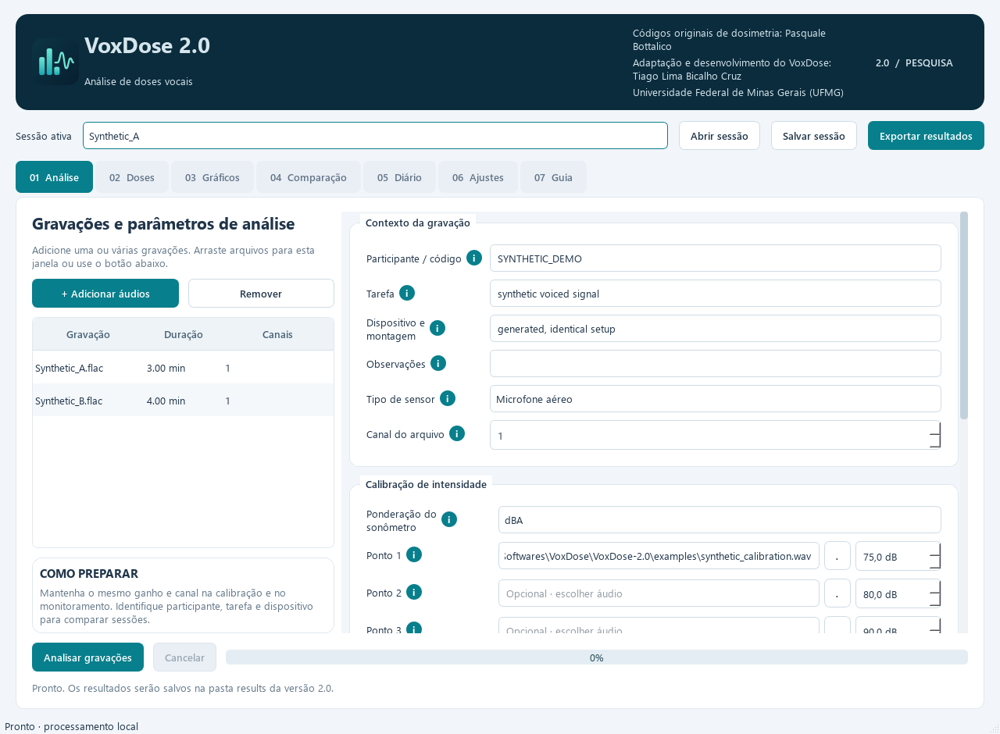

# VoxDose 2.0 — português brasileiro

Software científico para doses vocais, comparação de gravações longas e registro descritivo de esforço e fadiga percebidos. Revisão **2.0.2**.

**Códigos originais de dosimetria em MATLAB: Pasquale Bottalico.**  
**Adaptação, desenvolvimento e modernização do VoxDose: Tiago Lima Bicalho Cruz — Universidade Federal de Minas Gerais (UFMG).**

[README em inglês](README.md) · [Manual em português](docs/Manual_pt_BR.pdf) · [Manual em inglês](docs/Manual_en.pdf)

## Uso

A interface inicia em **inglês**. Para português: **Settings > Language > Português brasileiro > Apply preferences**. Passe o mouse sobre `(i)` para ler a explicação imediatamente, sem clicar e sem botão OK. É possível desabilitar as dicas em Ajustes.

Há abas de análise, doses, gráficos, comparação, diário, ajustes e guia. O processamento usa blocos, progresso e cancelamento. A exportação inclui Excel, CSV, sessões `.voxdose`, painel conjunto, gráficos individuais e tabela completa em PNG.



## Executar o código

Use Python 3.11+. Crie e ative um ambiente virtual, conforme o [README principal](README.md#run-from-source), e execute:

```bash
python -m pip install -e ".[dev]"
python main.py
```

Para explorar a comparação, abra as sessões artificiais de `examples`. Não são dados clínicos nem valores normativos. Para recalcular, selecione a calibração existente na sua própria cópia do projeto.

## Interpretação e calibração

Sem calibração, os níveis são digitais, em dBFS. Dd, De e Dr exigem SPL Z válido; dBA e dBZ não são intercambiáveis. Mudanças de ganho, montagem, posição ou acoplamento exigem nova calibração. De é expressa em J/m³; Dr, em J. Sensores de contato permanecem experimentais.

CPPS/HNR e doses não são medidas diretas de fadiga, diagnósticos ou limites universais de segurança. O diário registra autorrelatos descritivos de 0 a 10, sem substituir instrumentos validados. Consulte [métodos](docs/METHODS.md) e [relatório](docs/REPORT.md).

## Distribuição

O EXE Windows independente de Python e o instalador NSIS com ambos os manuais foram gerados e testados localmente. Binários grandes não ficam na árvore Git; publicar o código não significa enviar uma release binária ao GitHub. Os scripts estão em `tools` e o instalador em `installer`.

Na instalação Windows, os dados ficam em `%LOCALAPPDATA%\VoxDose`, separados do programa e preservados na desinstalação. No portátil, ficam ao lado do EXE.

**macOS depende de compilação e validação nativas.** Execute `bash Build-macOS.command` em um Mac para produzir `.app`, `.dmg` e `.pkg` da arquitetura utilizada. Nenhum aplicativo Mac foi gerado ou validado para esta revisão. O `.pkg` interno do PyInstaller Windows não é um instalador Apple. A notarização Apple não está configurada.

## Validação e histórico

São **53 testes de regressão**. A entrega Windows passou em três rodadas do EXE e três ciclos de instalação, abertura e desinstalação. A validação sintética atingiu **142/144 critérios**; dois critérios de F0 a SNR 10 dB seguem não atingidos e o script retorna código 1 para registrar a limitação. Veja [os registros](validation/README.md).

O código anterior está em [legacy/v1](legacy/v1). O manuscrito, bibliografia e figuras históricas permanecem intactos. A licença não comercial existente foi preservada: leia [LICENSE](LICENSE). Os créditos dos algoritmos originais e da adaptação do VoxDose continuam distintos.
