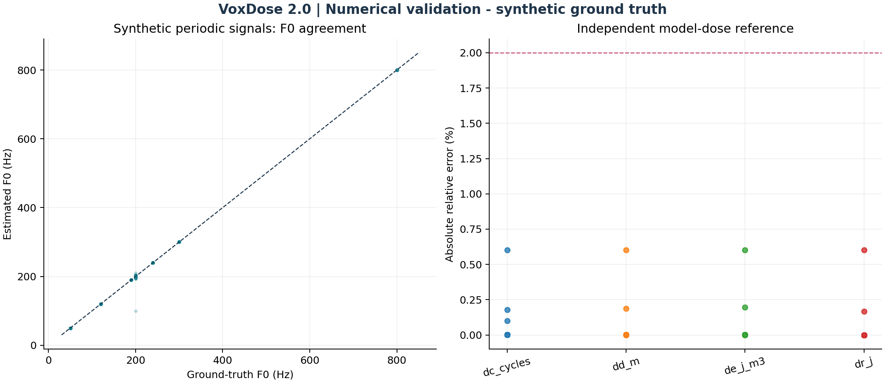

# VoxDose 2.0 - relatório de pesquisa e desenvolvimento

**Tiago Lima Bicalho Cruz**  
**Universidade Federal de Minas Gerais (UFMG)**  
15 de novembro de 2026

Adaptação dos códigos originais de dosimetria de **Pasquale Bottalico**. Desenvolvimento e modernização da versão 2.0 atribuídos a **Tiago Lima Bicalho Cruz**. Este relatório descreve a implementação entregue, suas verificações e seus limites; não constitui validação clínica.

## Resultado entregue

A versão 2.0 foi criada em uma pasta própria, preservando o material anterior. Inclui aplicativo PySide6, sete abas, português brasileiro/inglês, comparação de gravações longas, processamento em blocos, tabela de doses revisada, 13 tipos de gráficos individuais e painel conjunto, sessões reabríveis, diário perceptivo, calibração de um a três pontos e modo experimental para sensores de contato. Foram produzidos dois manuais ilustrados, exemplos artificiais e documentação dos métodos.

## 1. O que havia na pasta e como o software evoluiu

O inventário inicial catalogou **204 arquivos originais**, aproximadamente **1,40 GB em unidades decimais**, com SHA-256. A leitura reuniu **151 seções de código/texto**, incluindo conteúdos de ZIP, documentos Word extraídos e os artigos PDF. Arquivos binários, áudio, imagens, instaladores e planilhas foram inventariados; não se afirma ter revisado o código de máquina dos executáveis. Não foram encontrados AGENTS.md aplicáveis na árvore examinada. Os originais não foram editados.

A sequência identificada foi: rotinas MATLAB nos Arquivos Aaron, incluindo Analisi_Wav_SPL_F0.m e DOSI.m; traduções/adaptações em Python e cópias Backup; interface principal em Python; e organização em pacotes voxdose_core, voxdose_gui e voxdose_reports para o JOSS. Existem referências históricas a rotinas cepstrais de Naotoshi Seo. A extração atual de F0 utiliza Praat/Parselmouth.

**Os fontes principais encontrados já utilizavam PySide6.** Não foi localizada implementação Tkinter nos fontes ou ZIP examinados. Portanto, a 2.0 é uma reconstrução e modernização da arquitetura disponível, sem afirmar uma migração direta de um código Tkinter que não estava presente.

Havia divergências de versão entre título da janela, metadados JOSS e egg-info, caminhos de recursos dependentes do diretório corrente e a dependência equivocada `parselmouth` em um pyproject, em lugar de `praat-parselmouth`. A nova versão padroniza 2.0.0 e resolve recursos em relação ao pacote.

## 2. Atendimento aos pedidos

| Pedido | Implementação entregue |
|---|---|
| Pesquisar fadiga e esforço | Revisão dirigida de fontes primárias; medidas complementares e diário perceptivo, com distinção entre exposição e sintomas |
| Versão 2.0 em PySide6 | Sete abas: Análise, Doses, Gráficos, Comparação, Diário, Ajustes e Guia |
| Comparar gravações longas | Múltiplas sessões; totais e taxas por hora; janelas temporais; eixo absoluto/relativo; diferenças condicionadas à compatibilidade |
| Hunter e sensores de contato | Tipo de sensor, canal explícito, montagem documentada e calibração experimental multiponto com restrições de uso |
| Ícone, créditos e filiação | Símbolo de barras/onda preservado em SVG/PNG/ICO; original arquivado; crédito a Bottalico e desenvolvimento 2.0 em nome de Tiago, UFMG |
| Português e inglês | Interface, ajuda e novas exportações traduzidas; preferência persistente |
| Gráficos e doses | Painel conjunto, 13 tipos individuais, janelas ampliadas, PNG/SVG, tabela ordenável/buscável/copiar/intervalo |
| Tutoriais (i) desativáveis | Explicações em campos e medidas; chave em Ajustes; guia permanece disponível |
| Modernização adicional | Arrastar arquivos, lote, processamento fora da interface, progresso, cancelamento, temas claro/escuro e sessões portáteis |
| Dois manuais com imagens | PDFs e HTML independentes, em português brasileiro e inglês, com telas reais do aplicativo e dados sintéticos identificados |
| Outras sugestões | Diário, HNR exploratório, percentis, amplitude em semitons, perfis temporais e rastreabilidade implementados; itens opcionais descritos abaixo |

## 3. Medidas de fadiga e esforço: o que se encaixa

A pesquisa foi dirigida, consultando os artigos da pasta e fontes primárias disponíveis até 15/11/2026. Não é uma revisão sistemática com protocolo, avaliação formal de viés ou busca exaustiva.

O consenso de Hunter e colaboradores diferencia demanda vocal, resposta à demanda, esforço e fadiga. Isso favorece registrar as características acústicas, o contexto e a percepção separadamente. **Decisão de projeto:** não produzir um score automático de fadiga a partir de uma dose isolada. [Hunter et al., 2020](https://pmc.ncbi.nlm.nih.gov/articles/PMC7210446/)

O estudo de restauração após esforço vocal avaliou medidas perceptivas, aerodinâmicas e acústicas e observou respostas diferentes entre elas. **Aplicação:** permitir avaliações antes, após e no acompanhamento, sem pressupor que CPPS ou F0 mudem sempre na mesma direção. [Restoration Strategies Following Short-Term Vocal Exertion](https://pmc.ncbi.nlm.nih.gov/articles/PMC8632512/)

O protocolo semiautomatizado de estudos de carga associado ao grupo de Hunter destaca definições e condições consistentes de coleta. **Aplicação:** campos de participante, tarefa e dispositivo; parâmetros registrados; comparação condicionada à compatibilidade. [A Semiautomated Protocol](https://pmc.ncbi.nlm.nih.gov/articles/PMC9372227/)

| Medida/abordagem | Decisão e justificativa |
|---|---|
| Dt, Dc/VLI, Dd, De, Dr | Mantidas como exposição; equações, unidades e calibração revistas |
| Médias, desvios e percentis de F0/SPL | Implementados para distribuição e evolução; não recebem ponto de corte de fadiga |
| F0 P90-P10 em semitons | Implementado como amplitude robusta, sensível ao contexto/tarefa |
| CPPS em 5 s | Mantido e reformulado com protocolo explícito; não específico de esforço/fadiga |
| HNR | Implementado como complemento exploratório; dependente de ruído, sensor e tarefa |
| Trechos fonados e pausas | Implementados para caracterizar a distribuição temporal; ausência de fonação detectada não prova repouso ou reparação tecidual |
| Esforço/fadiga/desconforto 0-10 | Implementados como registros numéricos descritivos independentes, sem alegar validação psicométrica |
| VFI/IFV | Relevante, mas não reproduzido nem convertido em uma escala abreviada própria; integração futura deve usar versão validada e condições de uso adequadas |
| Jitter e shimmer em gravações longas | Não adotados como indicadores automáticos de fadiga; têm exigências de periodicidade/tarefa e são frágeis na fala contínua |
| H1-H2, CPP ajustado, razões espectrais e DPI | Não transplantados entre sensores/protocolos; exigem especificação e validação adicionais |
| Pressão subglótica, PTP e IBIF | Não apresentados como medidos por um áudio genérico; dependem de instrumentação ou modelos individualizados |

O VFI foi desenvolvido como instrumento de autorrelato com propriedades psicométricas próprias. O diário numérico desta versão é um recurso diferente e não recebe o nome VFI. [Nanjundeswaran et al., 2015](https://pubmed.ncbi.nlm.nih.gov/25795356/)

Trabalhos de monitoramento ambulatorial exploram doses e padrões contíguos de fonação/não fonação. **Aplicação:** tempo sem fonação, intervalos de 0,25 s e 5 s, duração máxima e mediana de trechos fonados, além de taxas normalizadas. Os limites usados aqui são descritores de segmentação, não limiares clínicos. [Mehta et al., 2015](https://pmc.ncbi.nlm.nih.gov/articles/PMC4607864/)

## 4. Eric Hunter e colaboradores: contribuições para sensores de contato

**Calibração e configuração NCVS, 2004.** O memorando presente na pasta é o Online Technical Memo **No. 2**, versão 2.4, com Švec, Hunter, Popolo, Rogge-Miller e Titze. A referência antiga da pasta o identificava como No. 11. O documento descreve ajuste individual do detector, faixa de frequência, artefatos e relação entre vibração cutânea e SPL. **Incorporação:** sensor/canal explícitos, registro de montagem, limites ajustáveis e calibração própria. O VoxDose 2.0 não reproduz integralmente o sistema NCVS nem seu detector de artefatos.

**Trajetórias de recuperação, 2009.** Hunter e Titze acompanharam avaliações após tarefa de carga em 86 adultos. O trabalho descreve uma trajetória temporal de recuperação, mas não fornece uma função universal aplicável a qualquer usuário. **Incorporação:** diário com data/hora e momentos antes/após/acompanhamento. Não foi implementada previsão individual de horas necessárias de repouso. [Hunter & Titze, 2009](https://pubmed.ncbi.nlm.nih.gov/19663377/)

**Comparação de doses, 2015.** Titze e Hunter discutem medidas vibratórias e modelos de risco potencial, incluindo hipóteses de colisão. **Decisão:** preservar doses como medidas de exposição, sem converter a saída deste programa em limite universal de dano ou em dose de colisão medida. [Titze & Hunter, 2015](https://pubs.asha.org/doi/full/10.1044/2015_JSLHR-S-13-0128)

**Caracterização de microfones comerciais, 2025.** O resumo de Castillo-Allendes, Berardi, Yousef e Hunter apresenta caracterização de dispositivos com excitador mecânico. É uma fonte de congresso, com alcance diferente de uma validação clínica completa. **Aplicação:** registrar o modelo e a montagem; não assumir equivalência apenas porque os sensores são chamados “de contato”. [The Voice Foundation, 2025](https://voicefoundation.org/view/2025-abstracts/entry/2874/)

**Prova de conceito à beira-leito, 2026.** Castillo-Allendes, Figueroa-Martínez, Cantor-Cutiva, Berardi e Hunter estudaram dois adultos treinados e dois microfones de contato em condições simuladas. F0 e CPPS apresentaram estabilidade promissora; houve diferenças dependentes do dispositivo em outras medidas. O estudo tem amostra muito pequena, não incluiu pacientes disfônicos e não avaliou carga prolongada/fadiga. **Incorporação:** modo experimental com F0/CPPS, identificação do sensor e cautela nas comparações. O artigo não valida o VoxDose nem seus cálculos. [Castillo-Allendes et al., 2026](https://doi.org/10.1007/s00405-025-09970-0)

**Variabilidade entre dispositivos, 2026.** Foi localizado o registro de resumo “Contact microphone testing: Variability between devices of the same brand and model”. O acesso integral pelo provedor não foi concluído, de modo que não se extraíram estimativas quantitativas nem se tratou o resumo como validação. **Contribuição para o projeto:** registrar cada montagem e não transferir um fator de calibração entre dispositivos. [JASA, DOI 10.1121/10.0044981](https://doi.org/10.1121/10.0044981)

### O modo de contato implementado

Sem calibração própria, apresenta dBFS e medidas de tempo, ciclos e periodicidade. Para estimar SPL, exige três pares de áudio/nível externo, abrangendo pelo menos 10 dB. Ajusta uma regressão linear em dB e guarda coeficientes, resíduos e R². Esses valores são indicadores de ajuste nos pontos, não de exatidão clínica.

Uma referência A permite estimativa A, mas não reconstrução automática do nível Z de um sinal de contato. Nesse caso Dd, De e Dr ficam indisponíveis. Referências Z permitem estimativas modeladas, claramente experimentais. Não há conversão de unidades digitais em aceleração física sem sensibilidade instrumental conhecida. O acoplamento, a anatomia, a posição e o ganho precisam permanecer estáveis; o programa não verifica isso automaticamente.

## 5. Correções dos cálculos antigos

Foram revistos o estimador chamado dBA sem filtro A, a dependência de janela/amostragem no nível, o sinal da distância, o pareamento temporal, o coeficiente empírico da amplitude, a referência SPL50, o denominador do percentual de fonação, as unidades de De/Dr e os desvios padrão.

O fator 0,05 em `A = 0,05 × L0 × sqrt((Pl-Pth)/Pth)` é um coeficiente do modelo, não um passo de tempo. A integração usa dt separadamente. De é energia por volume em **J/m³**, e Dr é energia radiada em **J**. O procedimento foi conferido com o artigo original fornecido, incluindo inspeção visual das equações. [Titze, Švec & Popolo, 2003](https://pmc.ncbi.nlm.nih.gov/articles/PMC3158591/)

**Consequência prática:** as planilhas 1.x não devem ser combinadas diretamente com as saídas 2.0. Reanalise os áudios originais com um mesmo método para uma comparação longitudinal. O arquivo METHODS.md detalha todas as fórmulas, escolhas e diferenças. Não se manteve um modo “legado” com rotulagem potencialmente incorreta apenas para reproduzir números antigos.

## 6. Comparação de gravações longas

O processamento lê blocos de 30 s, usa contexto para F0 e mantém características por quadro, evitando carregar toda a forma de onda. A memória ainda cresce com o número de quadros e sessões abertas. O CSV por quadro é compactado; a planilha Excel contém resumos e janelas, contornando o limite de linhas de uma planilha com áudio muito longo.

As comparações mostram totais, percentuais e taxas por hora gravada, além de curvas por janela, F0, CPPS e ciclos acumulados. A primeira sessão marcada é a referência. A diferença é descritiva; não é uma estatística inferencial. Participante, tarefa e dispositivo devem estar preenchidos e iguais; configurações incompatíveis bloqueiam os deltas. Os valores individuais continuam visíveis.

É possível alinhar pelo tempo real desde o início ou por percentual da duração. O segundo modo facilita examinar perfis de comprimentos diferentes, mas não sincroniza eventos reais. Pausas classificadas pelo detector não demonstram recuperação fisiológica. A tabela permite também analisar um intervalo com ponderação parcial dos quadros que cruzam seus limites.

## 7. Interface, tabela e gráficos

Foram aplicados hierarquia visual, paleta teal/azul, espaço entre controles, cabeçalhos consistentes, temas claro/escuro, ajuda contextual e sete abas. O símbolo original de barras e onda foi redesenhado em vetor; o bitmap original permanece preservado.

A tabela oferece unidade separada do valor, descrição do método, busca, ordenação numérica, cópia e exportação do intervalo. Indisponibilidade aparece como traço, sem substituir uma medida ausente por zero. A exportação Excel inclui cabeçalhos, filtros, linhas alternadas, painéis congelados, metadados e qualidade.

O painel conjunto reúne intensidade, F0, CPPS, ciclos, percentual de fonação e distribuições de F0, intensidade e CPPS. Também há HNR, envelope RMS, Dd, De e Dr acumuladas como gráficos individuais: **13 tipos individuais**. A forma de onda inteira foi substituída por envelope RMS por quadro para permitir inspeção de gravações longas sem alocar todo o áudio. Essa escolha está rotulada, sem chamar RMS de forma de onda bruta. Os gráficos podem ser ampliados; PNG e SVG compartilham o mesmo código do aplicativo.

## 8. Verificações realizadas

- **42 testes automatizados** do núcleo e da interface passaram na rodada registrada em validation/tests.xml. Incluem soluções analíticas de doses, invariância ao passo, correção de distância, média energética, intervalos parciais, canais, filtro A, calibração, cancelamento, persistência, idiomas, tutoriais e renderização de todos os tipos de gráficos.
- A gravação original `Arquivo Teste 11m20s.wav` tem, na cópia examinada, **713,672562 s (11 min 53,67 s)**. Foram processados **14.274 quadros** e **143 janelas acústicas**, em **14,38 s** nesta máquina. O crescimento de RSS entre início e fim foi aproximadamente 13,14 MB; esse número não é pico de memória.
- Um arquivo **sintético de duas horas**, 16 kHz, com F0 conhecida e sem CPPS, produziu **144.000 quadros**, em **8,09 s**, com **pico de RSS amostrado de 252,91 MB**. Arquivo FLAC de aproximadamente 13,45 MB. Esse ensaio não representa duas horas de fala natural.
- A integração também foi verificada com uma tabela artificial correspondente a **quatro horas**, 288.000 quadros.
- As telas dos manuais foram geradas pelo aplicativo com dados artificiais identificados como demonstração, em ambos os idiomas.
- A revisão 2.0.1 inclui um executável único Windows com o interpretador e suas dependências. As três rodadas de verificação do mesmo arquivo estão registradas em validation/corrections/three_runs.json, incluindo interface nos dois temas, análise e exportação.

Tempos e uso de memória dependem do hardware, formato, canais, F0 e cálculo de CPPS. Os ensaios não verificam exatidão clínica, identificação de falante, calibração metrológica do conjunto, robustez em ruído real ou equivalência entre sensores. Esses itens exigem estudo específico.

## 8A. Validação sintética com ground truth conhecido

Atendendo ao pedido adicional, foi executada uma bateria independente com **17 condições/casos**, **144 critérios de aceitação** e **3 verificações descritivas sem critério de aprovação**. Resultado: **142 critérios aprovados e 2 não atingidos**. Os objetivos não foram relaxados para converter falhas em aprovação.

Os sinais têm frequência, duração, amplitudes, pausas e semente aleatória conhecidas. O nível físico é **atribuído numericamente** a partir de uma sensibilidade de 0,05 unidade digital/Pa, com referência de 20 µPa. Calibrações de 60, 75 e 90 dBZ são sintetizadas. Isso verifica o processamento e as unidades, sem constituir calibração de um microfone físico. Um calculador escalar separado resolve as doses diretamente a partir dos segmentos especificados, sem chamar a função de integrandos do aplicativo nem usar F0/SPL extraídos para formar a referência.

Foram avaliados tons de 50 a 800 Hz, somas de harmônicos, degraus de nível e de F0, chirp de 100 a 400 Hz, pausas conhecidas, quadro final parcial, taxas de 11025/16000/44100/48000 Hz, ruído a SNR 30/10/0 dB, ruído branco sem fonte periódica, ponderação A contra resposta nominal independente e o fluxo sintético de duas horas. CPPS e HNR **não possuem ground truth analítico nesta bateria**; seus valores são apenas caracterizados.

| Caso / medida | Esperado / obtido | Erro absoluto |
|---|---|---|
| 120 Hz: tempo fonado (s) | 20 / 20 | 0 |
| 120 Hz: ciclos | 2400 / 2400,01264557 | 0,01264557 |
| 120 Hz: Dd (m) | 11,99964966 / 11,99969393 | 0,00004428 |
| 120 Hz: De (J/m³) | 15886,79689091 / 15886,88755248 | 0,09066157 |
| 120 Hz: Dr (J) | 0,00062832 / 0,00062832 | 4,882529e-12 |
| Fonação/pausas: Dt (s) | 20 / 20 | 0 |
| Duas horas: Dt (s) | 2880 / 2880 | 0 |
| Duas horas: ciclos | 518400 / 518401,32862576 | 1,32862576 |
| SPL A harmônico atribuído (dBA) | 66,90428766 / 66,90149914 | 0,00278851 |

**Critérios numéricos declarados:** erro mediano de F0 ≤0,5 Hz; percentil 95 do erro relativo de F0 ≤1%; perda de detecção ≤2% em trechos internos; erro relativo de Dc ≤1,5% e de Dd/De/Dr ≤2%; erro mediano de SPL Z ≤0,05 dB; SPL A harmônico ≤0,15 dB. O teste de duas horas usa critérios próprios, inclusive erro de ciclos ≤0,1%. Transições admitem no máximo um quadro de 50 ms por fronteira mais tolerância de borda. Os limites completos estão no CSV, não representam pontos de corte clínicos.

**Limitação observada a SNR 10 dB:** no sinal harmônico de 200 Hz, o erro mediano de F0 foi **0,922332 Hz**, acima de 0,5 Hz; o percentil 95 do erro relativo foi **1,163191%**, acima de 1%. Esses dois critérios permanecem não atingidos e o script termina com código 1 para tornar essa condição explícita. A bateria a 0 dB foi mantida como caracterização, sem alegação de precisão garantida. Não foi acrescentado um filtro ajustado apenas para fazer o teste passar.

**Correções motivadas pelos testes:** o limiar de validação foi reduzido para 20 dB A, pois o tom de 50 Hz a 65 dBZ sofre forte atenuação em A e o limiar inicial de 45 dB o rejeitava por configuração. Isso não era erro do rastreador de F0. Além disso, o detector passou a rejeitar quadros de amostras exatamente zero: a cauda do filtro A e o contexto do Praat não podem, juntos, criar fonação em silêncio digital verdadeiro. Essa correção recebeu teste automatizado de regressão. As rodadas anteriores e os resultados foram preservados em history.

Os áudios sintéticos, parâmetros e hashes estão em validation/synthetic_ground_truth/signals e ground_truth.json. O arquivo measurements.csv contém referência, estimativa, erro absoluto/relativo, unidade, tolerância e resultado por critério. summary.json e VALIDATION.md resumem a rodada. O teste de duas horas encontrou 518.401,328626 ciclos para 518.400 esperados: erro relativo aproximado de **0,0002563%**, com Dt exatamente igual aos 2.880 s especificados.

Esses resultados verificam consistência numérica e desempenho em sinais conhecidos. Não demonstram exatidão clínica em vozes disfônicas, ambientes reais ou sensores de contato; tampouco validam as hipóteses biológicas dos modelos de dose.

## 9. Sugestões implementadas para sua decisão

1. **Diário perceptivo:** mantido opcional, sem impedir o fluxo acústico. Pode ser retirado se o foco pretendido for estritamente dosimétrico.
2. **HNR exploratório:** acompanha a opção CPPS/HNR; pode ser desligado para reduzir processamento. Não recebe interpretação automática de esforço.
3. **Percentis e amplitude em semitons:** oferecem distribuição além da média; não são escores novos de fadiga.
4. **Padrões de fonação/pausas e taxas normalizadas:** ajudam a comparar durações diferentes e distribuição de uso.
5. **Sessões portáteis e rastreabilidade:** facilitam reabrir resultados e comparar dias sem recalcular áudio.
6. **Temas claro/escuro, arrastar arquivos e atalhos:** modernizam o uso cotidiano; idioma e dicas são configuráveis.
7. **Separação A/Z e restrição de calibração:** ampliam a transparência das unidades; são recomendadas para manter coerência científica.

Possíveis próximos estudos incluem validação por tarefa/sensor, comparação cega com Praat e um sistema de referência, teste de repetibilidade de acoplamento, estimativa de incerteza e protocolo padronizado de gravação. Pressão subglótica, dose de colisão, IBIF e índices de fonotrauma exigem dados e validação adicionais; não foram simulados como funcionalidades prontas.

## 10. Autoria, filiação e materiais históricos

Na interface, metadados, manuais, README e CITATION.cff consta: **Tiago Lima Bicalho Cruz - Universidade Federal de Minas Gerais (UFMG)**. A versão 2.0 identifica como desenvolvimento seu a interface, arquitetura, processamento em blocos, comparações, gráficos, armazenamento, diário e documentação. Permanece o crédito de adaptação dos códigos originais de **Pasquale Bottalico** e a referência à fundamentação das doses. Isso não implica participação, revisão ou endosso desses pesquisadores sobre esta versão.

Os textos e artigos antigos não foram sobrescritos nem tiveram autoria/filiação histórica alterada. A filiação UFMG vale para a versão e documentação novas. Isso preserva a proveniência da pesquisa e dos manuscritos anteriores.

Existe uma pendência concreta de licença: o pyproject/egg-info/splash antigos indicam MIT, enquanto Installer/EULA.txt contém termos restritivos e menciona outro software, CepstralVox. A entrega não substitui esses termos nem define uma licença pública nova. Antes de distribuição pública, é necessário uniformizar essa decisão e os avisos de componentes de terceiros. O desenvolvimento local solicitado foi concluído sem publicar o software.

## 11. Arquivos para revisão

Abra Start-VoxDose.cmd. Os fontes estão em voxdose; a distribuição portátil em dist/VoxDose-2.0; os manuais PDF/HTML e este relatório em docs; as sessões e sinais artificiais em examples; os registros de testes em validation. As análises novas ficam em results, sem escrever ao lado do áudio original. A pasta audit conserva inventário, extrações e material da auditoria.

## 12. Revisão corretiva 2.0.1

A revisão responde aos problemas observados no Windows após a primeira entrega. Os códigos originais de dosimetria continuam atribuídos a **Pasquale Bottalico**; a adaptação e o desenvolvimento do VoxDose são atribuídos a **Tiago Lima Bicalho Cruz - UFMG**. Os dois créditos aparecem juntos no cabeçalho, sem slogan comercial, e também nas imagens exportadas.

O empacotamento foi alterado de pasta com dependências externas para **um único VoxDose-2.0.exe**, incluindo o interpretador Python, bibliotecas de áudio, Qt/PySide6, manuais e recursos. O backend SVG é incluído explicitamente, corrigindo o erro de exportação `No module named matplotlib.backends.backend_svg`. O iniciador não tenta mais recorrer a um Python instalado.

O aplicativo agora define uma paleta completa para os temas claro e escuro, independente do tema do Windows. São explícitos os fundos e textos de caixas de informação, listas, seleções, títulos de grupos e diálogos. As mensagens dos botões (i) usam texto branco em fundo escuro. Os ícones dos controles dos gráficos têm versões de contraste definidas. O diálogo de ajustes passa a desativar o mecanismo automático de layout enquanto permite alterações manuais, para que os controles tenham efeito.

No trecho questionado de F0, uma janela de um minuto continha apenas um quadro de 50 ms próximo de 418 Hz, e outra continha três quadros. A média era numericamente calculada sobre essas poucas detecções; a linha contínua estendia sua aparência através de intervalos sem fonação. A correção é de apresentação: a curva é interrompida em pausas, os intervalos sem fonação detectada de pelo menos 0,5 s recebem fundo cinza, e a média só aparece em janelas com pelo menos 0,5 s e 5% de fonação detectada. Os pontos originais continuam disponíveis; as doses não foram alteradas para ocultar candidatos. Não foi introduzido um VAD treinado nem se afirma separar falantes ou ruído periódico automaticamente.

Cada exportação de tabelas também gera **VoxDose_results.png**, com doses, demais medidas, unidades, descrições e os créditos de origem/adaptação. Os testes de regressão cobrem a pausa, a média de candidatos esparsos, a redução de pontos que preserva lacunas, a tabela PNG, os dois temas, a informação em branco e o efeito dos ajustes do gráfico. A execução de entrega é verificada em três cópias isoladas do mesmo EXE, com PATH sem Python e sem pasta _internal; os resultados detalhados ficam em validation/corrections.

## 13. Revisão 2.0.2: ajuda imediata e distribuição

Novas configurações iniciam em inglês, com português brasileiro selecionável e persistente. Os símbolos (i) passam a ser rótulos de informação que exibem uma dica imediatamente ao receber o mouse ou foco de teclado; não abrem uma caixa modal. A ajuda mantém texto branco e pode ser desabilitada em Ajustes.

O Windows recebe um instalador NSIS 3.13 por usuário, contendo o mesmo EXE independente de Python, ambos os manuais ilustrados, relatório e créditos. A instalação oferece atalhos e desinstalador. Os dados da versão instalada ficam em %LOCALAPPDATA%/VoxDose, separados do programa e preservados na desinstalação. São removidos apenas arquivos conhecidos da instalação, sem exclusão recursiva da pasta.

Não foi gerado nem validado um executável macOS neste computador Windows. O arquivo build/onefile/VoxDose-2.0/VoxDose-2.0.pkg é um CArchive interno do PyInstaller com DLLs Windows, não um instalador Apple. A compilação nativa preparada em tools/build_macos.py cria .app, verifica três execuções e gera .dmg/.pkg na arquitetura do Mac usado. O pacote de fontes está explicitamente identificado como material de compilação. A assinatura Developer ID pode ser fornecida no ambiente; a notarização Apple não está configurada. Dados de uma futura compilação Mac ficam em Library/Application Support/VoxDose, fora do aplicativo.

As evidências desta revisão ficam em validation/release_2.0.2. O núcleo de análise numérica não foi alterado. Os códigos originais de Pasquale Bottalico e a adaptação/desenvolvimento de Tiago Lima Bicalho Cruz - UFMG continuam distinguidos no software, nos manuais e na distribuição.

## Referências complementares

- Bottalico P, Nudelman CJ. Do-It-Yourself Voice Dosimeter Device: A Tutorial and Performance Results. 2023. https://doi.org/10.1044/2023_JSLHR-23-00060
- Bottalico e colaboradores. Do-It-Yourself Voice Acoustic Analysis: A Companion to the DIY Voice Dosimeter Device. 2025. https://doi.org/10.1016/j.jvoice.2025.09.032
- Švec JG, Titze IR, Popolo PS. Estimation of sound pressure levels of voiced speech from skin vibration of the neck. 2005. https://pubmed.ncbi.nlm.nih.gov/15807026/
- Fryd AS, Van Stan JH, Hillman RE, Mehta DD. Estimating Subglottal Pressure From Neck-Surface Acceleration During Normal Voice Production. 2016. Artigo fornecido na pasta Papers. https://doi.org/10.1044/2016_JSLHR-S-15-0430
- Praat. PowerCepstrogram: Get CPPS. https://uvafon.hum.uva.nl/praat/manual/PowerCepstrogram__Get_CPPS___.html
- Qt. Threads and QObjects. https://doc.qt.io/qtforpython-6.10/overviews/qtdoc-threads-qobject.html

Consulta e implementação: 15/11/2026. Para reprodução dos resultados, use os parâmetros e versões efetivamente registrados em cada sessão.
